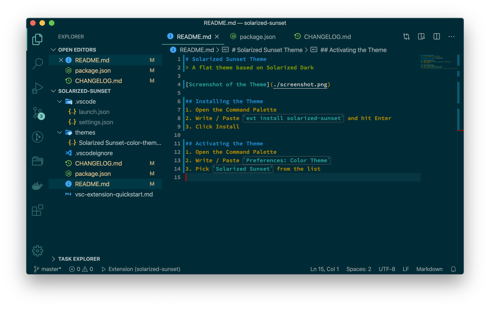
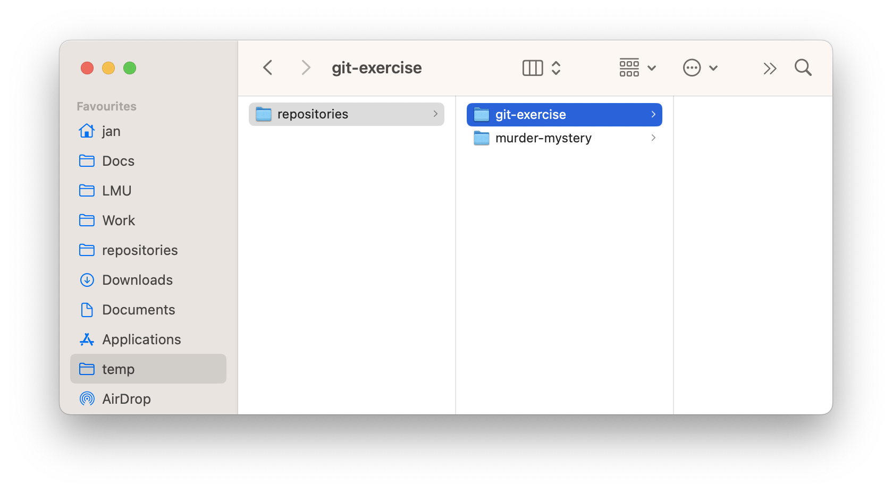

## What is this part about?

- **Goal**: Learn everything that is necessary to...
  - create your own repository in GitLab
  - use branches and merge requests to make and review a change
  - including a change made with Claude Code
- **Format**: Mix of theory & practicals
  - Feel free to always ask questions any time!

## Agenda & Timeline

::: {.nonincremental}

- 10:20 - 12:00 **Part 2.1** (1:40)
  - **Block 1:** Introduction & Basics
  - **Block 2:** Branches & More
- 12:00 - 13:00 *Lunchbreak* 🍲
- 13:00 - 14:40 **Part 2.2** (1:40)
  - **Block 3:** Collaboration via GitLab
  - **Block 4:** Merge Requests & Claude Code

:::

## Prerequisites (Any Problems?)

- Software
  - *git*: The tool itself
  - *Visual Studio Code*: A text editor, which also allows using git via its graphical user interface (GUI)

- *Helmholtz GitLab*: Website to collaborate via git
- Setup guide: <https://gitlab.com/digital-research-academy/setup-git-gitlab>

## Text Editor: Visual Studio Code

## Text Editor: Visual Studio Code

- Text Editor: A program to write text
  - Only text i.e. no layouting / formatting (unlike Microsoft Word)

- Quick Demonstration
  - Opening workbench in a folder

## Practical: Folder Structure {background-color="black"}

## Practical: Text Editing {background-color="black"}

1. Open Visual Studio Code on your computer
    - Explore the UI
    - Set a theme if you want to
2. Create a new folder called `repositories`
3. Inside it, create a new folder called `git-exercise`
4. Open `git-exercise` in Visual Studio Code
    - Create a new file `test.txt` and write in it   `Hello World!`

## *End of Section* 🎉 {background-color="black"}

:::{.r-fit-text}
Any Questions?
:::

[[🏡 Back to Overview]](./index.html)

[[⏩️ Next Section]](./1.1-what_is_git.html) 
