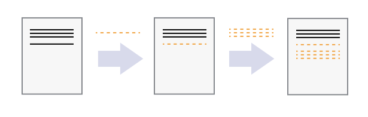

## First things first: Language 🇬🇧/🇩🇪

::: {.nonincremental}

- Slides are in English
- Spoken: German or English?
  - Do you have a preference?

:::

## Introductions: Who am I? 🙋🏼‍♂️

::: {.nonincremental}

- Jan Simson
- Background
  - Computer Science (Ausbildung)
  - MSc Behavioural Data Science (Amsterdam)
  - PhD Statistics (München)
  - Digital Research Academy (DRA)
  - Worked at research lab & startup before
- Worked with `git` for a couple of years

:::

## Introductions: Who are you? 🙋🏻‍♀️🙋🏽‍♂️🙋

Show of hands.

- How many of you have used git before?
- How many have used agentic tools? e.g. Claude Code
- How many of you consider yourself primarily researchers?
- How many of you consider yourself primarily software developers / engineers?
- Any other groups? Admin / management / ...?

## What is the course about?

- **Goal**: By the end of the day you can...
  - explain what version control can do for a research group
  - use branches and merge requests in GitLab to make and review a change
  - take home a first draft of a shared Git guide
- Feel free to always ask questions any time!

## Agenda & Timeline*

::: {.nonincremental}

- 09:30 - 10:30 **Part 1:** Input, Introduction and Discussion
- [10:30 - 10:50 *Pause* ☕️]{style="opacity: 0.5;"}
- 10:50 - 12:30 **Part 2.1:** Your Repository – Technical Basis
- [12:30 - 13:30 *Lunchbreak* 🍲]{style="opacity: 0.5;"}
- 13:30 - 15:10 **Part 2.2:** Your Repository – Technical Basis
- [15:10 - 15:30 *Pause* ☕️]{style="opacity: 0.5;"}
- 15:30 - 16:30 **Part 3:** Developing a Shared Git Guide
- [16:30 - 16:50 *Pause* ☕️]{style="opacity: 0.5;"}
- 16:50 - 17:30 **Part 3:** Developing a Shared Git Guide

:::

::: attribution
*The speed of these courses is always a bit variable.
:::

# What is `git`?

## Sounds Familiar? 📁

```text
analysis.py
analysis_v2.py
analysis_v2_final.py
analysis_v2_final_fix.py
analysis_v2_final_FINAL.py
analysis_v3_final_FINAL_comments.py
analysis_v3_final_FINAL_comments_fixed.py
```

::: {.fragment}
Version control replaces this with a single file and a full history of all its changes.

```text
analysis.py
```
:::

## What is Version Control?

- Records all changes to your files over time
  - **Who** changed **what**, **when** and (ideally) **why**
- Allows you to go back to any previous version
- Allows you to understand the evolution of a file
- Allows multiple people to work on the same files at the same time (while retaining their sanity)
- The most common tool for version control is `git`

## What is `git`?

- Version Control System (VCS)
  - Looks at the changes in your files
  - Records all changes over time to give you a full history
  - Similar to "track changes" in Microsoft Word / LibreOffice

::: {.fragment}



:::

## What is git? *Strengths* & Weaknesses

- Strengths 💪
  - Very hard to lose files with git
  - Great for collaboration
  - Fast (like, really fast)
  - History allows you to go back and understand changes or revert when there are problems
  - Reproducibility

## What is git? Strengths & *Weaknesses*

- Weaknesses 😢
  - Can be a bit complicated to use (esp. at first)
  - History takes up file space (but only little)
  - Struggles with binary (i.e. non-text) files
  - Struggles with large files
    - Not good for storing data!
  - You do need to *explicitly* use it i.e. it doesn't just work in the background

# Why *Version Control* Matters for *Research*

## Why does it Matter for Research? 🔬

- Research increasingly depends on code
  - Analysis scripts, modelling pipelines, simulations, data processing, ...
  - Even papers themselves
- Results are only as trustworthy as the code that produced them
- Teams can change over time (or a project is on ice)
- Collaborations

## Code as a Research Record 📜

- Like a lab notebook, a repository documents how results came about
- You can go back to exactly the version that was used for a paper, figure or dataset collection / generation
  - Even years later
  - Incredibly helpful when you need to write up a methods section (or reproduce a result)
    - I just had to answer a question about a data collection from 6 years ago and `git` saved me!

## Continuity: When People Move On 👋

- Mobility: A PhD student finishes, but their code might stay
- Without version control, code often lives on someone's laptop (or in someone's head)
- With a shared repository
  - Code is in a central place that the *group* owns
  - The history explains *why* things are the way they are
  - New people can pick up where others left off

## Publication and Collaboration

- Foundation of collaboration: `git` is the de-facto standard for collaboration on code
  - Although useful for more than just code, e.g. for writing papers, documentation, etc.
- Publication of code / packages
  - Higher chance for impact / uptake in the field


## Discussion {background-color="black"}

::: {.nonincremental}

- Where does the code of your group live right now?
- What would happen if the person who wrote it left tomorrow?

:::

# Reviewing

## Bringing Peer Review to Code 🔍

- We review papers before they are published, but code is rarely reviewed
- *Merge requests* bring a review step to code
  - Proposed changes to be integrated
  - Someone else looks at them, comments and approves them / potential back and forth; only then are they merged into the main version
  - Potential automatic checks
- Catches errors early & ensures certain trust / quality

## Review Doesn't Have to be Heavy 🪶

- A second pair of eyes is already a big improvement
  - Beneficial for both reviewer and reviewee
- Questions to ask in a review
  - Do I understand what this change does and why?
  - Does it do what it claims to do?
  - Could it break something else?
  - Is the code clear?

# AI Assistants and Accountability

## Let's Talk AI

Who's using what?

<https://pingo.coactum.de/>

1. Which AI coding assistants have you used?
2. What do you use them for? Are there specific functions you use them for?
3. Are there specific things that you think they should **not** be used for?

## AI Coding Assistants 🤖

- Can read, write and change code in your projects + execute commands
- Can save a lot of time & enable new use cases or more ambitious projects
  - e.g. for documentation, refactoring or understanding unfamiliar code
- **But**: They also do unanticipated things, and can introduce errors or security issues and may lead to code no one understands ⚠️

## Who is Accountable?

- AI tools cannot hold responsibility
- The person who merges a change is responsible for it
  - No matter who (or what) wrote it
- Version control makes changes by AI assistants **visible** & **reviewable**
  - Possible to review at different steps

## Open Science 🔓

- Sharing code makes research more transparent and reproducible
- Journals and funders increasingly expect code to be available
- When making code public, also think about
  - A license, so others know how they are allowed to use it -> <https://choosealicense.com/>
  - A `CITATION` file, so people know how to cite it
  - A DOI (digital object identifier), e.g. via [Zenodo](https://zenodo.org/about)

# Questions?

## Discussion: Open Questions? {background-color="black"}

Some of the questions your group will need to answer:

- Which tools do we / are we allowed to use?
  - Are there specific limits / guidelines on *how* we want to use them?
- Which code and data may be shared with them?
- Should changes made with an AI assistant be marked as such?
- ...any other specific questions?

## *End of Part 1* 🎉 {background-color="black" background-opacity="0.4" background-image="images/backgrounds/dolomites.jpg"}

:::{.r-fit-text}
Any Questions?
:::

[[🏡 Back to Overview]](https://digitalreasearchacademy-githereon-9be0f8.pages.hzdr.de/index.html)

[[⏩️ Next Part]](https://digitalreasearchacademy-githereon-9be0f8.pages.hzdr.de/2.1.0-intro.html)
