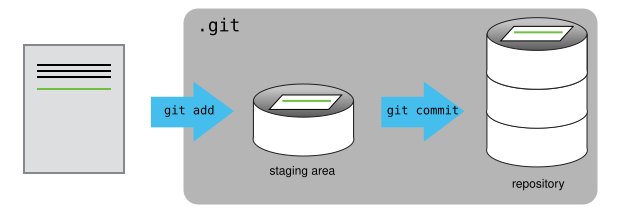
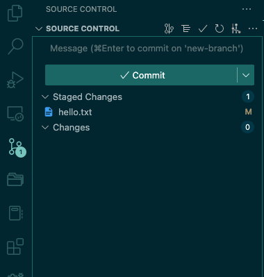

## The 3 Levels of Changes in git



- When we first make a change it is *unstaged*
- Once we `add` the change to the staging area it is *staged*
- We can then `commit` all *staged* changes

## Tracking Changes: `git add` and `git commit`


Files are added to the staging area with <br> `git add <path to file or directory>`

All files in the staging area are committed with <br> `git commit`

## Tracking Changes: `git add`

Files are added to the staging area with <br> `git add <path to file or directory>`.

```bash
# ...we write something into example.txt

git status
# Untracked files:
#   (use "git add <file>..." to include in what will be committed)
#   example.txt
```

Add `example.txt` to the staging area

```bash
git add example.txt

git status
# Changes to be committed:
#   (use "git rm --cached <file>..." to unstage)
#   new file:   example.txt
```

## Tracking Changes: `git add`

Changes are added to the staging area with <br> `git add <path to file or directory>`.

- You can use `git add .` to add all unstaged changes to the staging area
    - `.` always refers to the current directory
- You can also use `*` to represent any sort of filename
  - e.g. add all `.txt` files via `*.txt`

## Tracking Changes: `git commit`

All changes in the staging area are committed with <br> `git commit`

```bash
git status
# Changes to be committed:
#   (use "git rm --cached <file>..." to unstage)
#   new file:   example.txt
```

Let's commit the new change
```bash
git commit -m "Adding example.txt"
# [main (root-commit) ed61bb5] Adding example.txt
#  1 file changed, 1 insertion(+)
#  create mode 100644 example.txt

git status
# On branch main
# nothing to commit, working tree clean
```

## Tracking changes: `git commit`

- The name git "commit", might already suggest it, but once a change is *committed* it becomes significantly harder to remove it.
- The classic way to undo a committed change in git would be to make another commit with the reverse change.
- Modifying a commit is possible, but you should know what you are doing. Typically this is called "changing history" and is (esp. in collaborative settings) frowned upon.

## Demonstration

```git-sandbox
id: classic
title: The Classic Loop
prompt: "~/example $"
```

## Stuck in an Editor 🛗 

Forgot the `-m "insightful commit message"`?

- Every commit needs a message
- If you don't provide one, `git` will open an editor for you to write the message in
- This editor may also open itself for other `git` commands
  - Every line with a `#` at the beginning is a comment and will be ignored by `git` (usually some helpful extra info)
  - Save and close the editor for `git` to proceed

## Stuck in an Editor: Breaking Free ⛓️‍💥

The default editor in git is (usually) `vim`

- `vim` is notoriously hard to get out of
- Press `ESC`, then write `:wq` and hit `Enter`
- You can also change the default editor to e.g. VSCode
  - ⚠️ Important: Verify first whether you can start VSCode from the command line by running the `code` command
  - `git config --global core.editor "code --wait"`
- For fun: <https://github.com/hakluke/how-to-exit-vim>

## Stuck in an Editor

```git-sandbox
share: classic
title: Stuck in an Editor
```

# Questions?

# Demo: <br> Using git via the CLI

## Tracking changes: Practical (1/2) {background-color="black"}

1. Open VS Code in the directory `git-exercise` you created earlier
2. Create a new text file called `hello.txt` with the contents "Hello!"
3. Add the file to the staging area (`add`)
4. Commit the new file (`commit`)

Check what's happening between steps with `git status`.

## Tracking changes: Practical (2/2) {background-color="black"}

Check what's happening between steps with `git status`.

5. Change the text in `hello.txt` to read "Hello there!"
6. Add the file to the staging area (`add`)
7. Commit the change (`commit`)

## Seeing Changes: `git status` 👀

You can see the high-level changes and what is about to happen with <br>
`git status`

```bash
# ...we change the contents of example.txt

git status
# On branch main
# Changes not staged for commit:
#   (use "git add <file>..." to update what will be committed)
#   (use "git restore <file>..." to discard changes in working directory)
#         modified:   example.txt

# no changes added to commit (use "git add" and/or "git commit -a")
```

## Seeing Changes: `git diff` 👁️👄👁️

You can see the actual *unstaged* changes, line by line with <br>
`git diff`

```bash
# ...we changed the contents of example.txt

git diff
# diff --git a/example.txt b/example.txt
# index 10ddd6d..980a0d5 100644
# --- a/example.txt
# +++ b/example.txt
# @@ -1 +1 @@
# -Hello!
# +Hello World!
```

:::{.callout-note}
`git diff` only allows you to see changes to files which have already been committed before i.e. changing the contents of an existing file.
:::

## Un-Doing changes: `git restore`

You can *undo* any changes to files with <br>
`git restore`

```bash
# ...we changed the contents of example.txt

git status
# On branch main
# Changes not staged for commit:
#   (use "git add <file>..." to update what will be committed)
#   (use "git restore <file>..." to discard changes in working directory)
#         modified:   example.txt

# no changes added to commit (use "git add" and/or "git commit -a")

git restore example.txt

git status
# On branch main
# nothing to commit, working tree clean
```

## Un-Doing changes: `git restore`

You can *undo* any changes to files with <br>
`git restore`

- This is one of the super-powers of using git, allowing you to just go ahead and change your files without wasting time having to create backups

## Interim: The anatomy of a git command 🔍️

Git commands, like many other CLI tools follow a certain structure:

```bash
git status

git commit -m "Adding example.txt"

git config --global user.name "Your Name"
```

:::{.fragment}

With `-h` you can get help on any git command 🚨

```bash
git status -h
git commit -h
```

:::

# Questions? {background-opacity="0.4" background-image="images/backgrounds/questions.gif" background-position="top"}

I'm aware this was a lot to take in.

<!-- Src: https://giphy.com/gifs/dogs-puppy-confused-xT0xeuOy2Fcl9vDGiA -->

## Practical: git Command Library {background-color="black"}

1. Create a new file `library.txt` in your `git-exercise` directory
2. Run `git init -h` and copy the output into your `library.txt`
3. Explore the repo status using `git status`
4. Commit the changes (with a good commit message)
5. Delete the `library.txt` and restore it

## Demo: Tracking Changes in VSCode



- Demo!

## Note: Git and Code

- You have noticed that we're not using `git` with source code here
- Mainly for teaching purposes
  - Not everyone is comfortable coding in the same programming language
- However, also good to be aware that `git` can handle more than just code! 💪

## *End of Block* 🎉 {background-color="black" background-opacity="0.4" background-image="images/backgrounds/dolomites.jpg"}

:::{.r-fit-text}
Any Questions?
:::

[[🏡 Back to Overview]](https://digitalreasearchacademy-githereon-9be0f8.pages.hzdr.de/index.html)

[[⏩️ Next Block]](https://digitalreasearchacademy-githereon-9be0f8.pages.hzdr.de/2.2.1-gitignore.html) 
