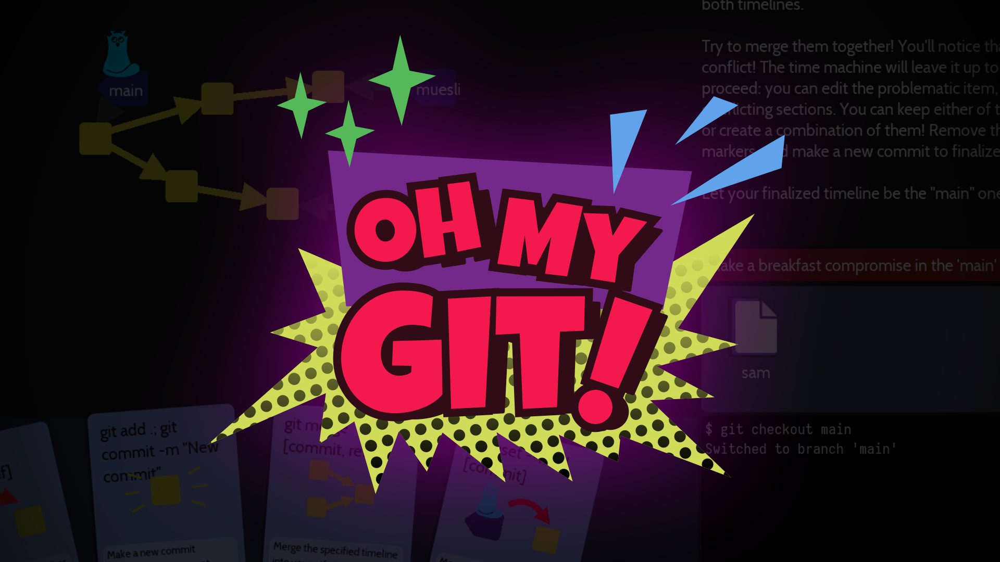

## Final Summary

- Initialize a repository with `git init`
- Stage your files with `git add`
- Whenever you made a substantial change, put it into the history with `git commit`
- See your history with `git log`
- Switch between branches with `git checkout`
- Create new branches with `git checkout -b`
- To collaborate, first `git pull` others changes, then `git push` yours
- Review changes (yours, your colleagues' and Claude Code's) via merge requests before merging them

# Going Beyond

## Guides to Re-Visit

Most of the information in these guides, we already covered, but they can be great if you want to re-visit anything.

- https://learngitbranching.js.org/
- https://github.com/git-guides
- [Introduction to RStudio Git & GitHub](https://lmu-osc.github.io/Introduction-RStudio-Git-GitHub/)
- [The Carpentries: Version Control with Git](https://swcarpentry.github.io/git-novice/)
- https://gitimmersion.com

## Git Game

## Further Reading

- Popular Workflow: [Trunk Based Development](https://www.atlassian.com/continuous-delivery/continuous-integration/trunk-based-development)
- Good guide: [Beej's Guide to Git](https://beej.us/guide/bggit/html/split/)
- Using git with data
  - [git lfs](https://git-lfs.github.com/)
  - [dvc](https://dvc.org/): Data Version Control
- If you have a problem
  - [ohshitgit.com](https://ohshitgit.com/) [(🇩🇪)](https://ohshitgit.com/de)
  - Google

## *End of Part 2* 🎉 {background-color="black" background-opacity="0.4" background-image="images/backgrounds/dolomites.jpg"}

:::{.r-fit-text}
Any Questions?
:::

[[🏡 Back to Overview]](./index.html)

[[⏩️ Next Part]](./3.0-git_guide.html) 
