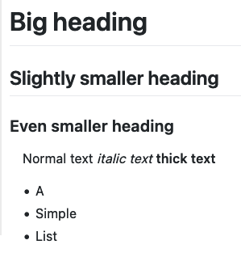

## Agenda

- [x] **Part 1:** Input, Introduction and Discussion 
- [x] **Part 2:** Your Repository - Technical Basis
- [ ] **Part 3:** Developing a Shared Git Guide ⬅️

## Agenda & Timeline

::: {.nonincremental}

- 15:30 - 15:40 Introduction to the session
- 15:40 - 16:30 Group work: Drafting the sections
- 16:30 - 16:50 *Pause* ☕️
- 16:50 - 17:10 Presenting and discussing the drafts
- 17:10 - 17:20 Compiling the sections into one guide
- 17:20 - 17:30 Next steps

:::

## Why a Shared Git Guide?

- `git` is very flexible, so every group uses it slightly differently
- A shared guide writes down how *your organization* wants to use it
  - Easier onboarding
  - Clarity
  - Consistency
- It doesn't have to be perfect, a first draft is already a great start!

## How We'll Work 🛠️

- Each group drafts one section of the guide
- We write the guide in Markdown, in a shared repository on GitLab
  - Using exactly what you learned in Part 2!
- Each group
  - create you own branch, e.g. `section-scope`
  - write your own section in its own file, e.g. `scope.md`
  - create a merge request once the draft is done

## Markdown

Markdown is a simple language for basic text formatting

- Markdown is widely used for simple text documents
- We will also use it to write our Git guide in Part 3
- It's also used for `READMEs`
  - These are files describing a repository / giving an introduction
  - They will be shown by default when you open a repository on a hosting website
- [Example 🐍](https://github.com/python/cpython)

## Markdown: The Basics

Markdown is a simple language for basic text formatting

```md
# Big heading
## Slightly smaller heading
### Even smaller heading

Normal text
*italic text*
**thick text**

- A
- Simple
- List
```

## Markdown: The Basics



## Which Sections do you Want to Include?


::: {.nonincremental}

- *Scope*: What goes into Git
- *Collaboration*: How we change shared code
- *AI assistants*: How we work with Claude Code
- *Continuity*: Reproducibility, publishing and handover

:::

## Theme: Scope 📦

Some questions to get you started:

::: {.nonincremental}

- Which projects and files belong into git, which don't (e.g. large data, passwords)?
- What do we put into our `.gitignore` files?
- Where do our repositories live (e.g. which GitLab group)?
- One repository per project, per paper or per person?

:::

## Theme: Collaboration 🤝

Some questions to get you started:

::: {.nonincremental}

- When do we work on branches and how do we name them?
- When do we use merge requests and who reviews them?
- What makes a good commit (message)?
- What do we do when we get stuck (e.g. in a merge conflict)?

:::

## Theme: AI Assistants 🤖

Some questions to get you started:

::: {.nonincremental}

- Which AI assistants do we use and what for?
- Which code and data may (not) be shared with them?
- How do we review changes made with an AI assistant?
- Do we mark these changes (e.g. in the commit message or merge request)?

:::

## Theme: Continuity 🔁

Some questions to get you started:

::: {.nonincremental}

- How do we make sure results can be reproduced later on?
- When and how do we publish our code (license, citation, DOI)?
- What happens to a repository when someone leaves the group?
- What documentation does every repository need (e.g. a `README`)?

:::

## Practical: Drafting a Section {background-color="black"}

1. Form groups and pick one of the themes
2. Clone the guide repository and create a new branch for your section
3. Discuss the questions and write down your group's answers in your section's Markdown file
    - Short and concrete is better than complete
4. Commit and push your changes regularly
5. Create a merge request once your draft is done

## Presenting the Drafts 🎤

- Each group presents their section (~5 min)
  - What did you decide on?
  - Where were you unsure or did you disagree?
- Everyone else: Questions, comments and additions
  - You can also comment directly in the merge request

## Practical: Compiling the Guide {background-color="black"}

1. Review the merge request of another group
2. Incorporate (or discuss) the feedback you received
3. Merge your section into `main`

## Next Steps 🚀

- The guide is a first draft, now it needs to be finalised
- Who finalises the guide (and by when)?
- How is the guide introduced to the rest of the group?
- How is the guide kept up to date?
  - Changes to the guide can be proposed via merge requests as well ✨

# Evaluation

## Sources

This course uses materials from, builds upon and is inspired by the following amazing resources ✨

- [The Carpentries: Version Control with Git](https://swcarpentry.github.io/git-novice/)
- https://lmu-osc.github.io/Introduction-RStudio-Git-GitHub/
- https://github.com/edunford/git-scavenger-hunt
- https://gitimmersion.com

# The End, Thank You! ❤️
