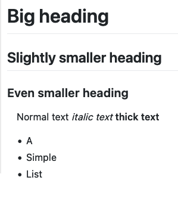

## Markdown

Markdown is a simple language for basic text formatting

- Markdown is widely used for simple text documents
- We will also use it to write our Git guide in Part 3
- It's also used for `READMEs`
  - These are files describing a repository / giving an introduction
  - They will be shown by default when you open a repository on a hosting website
- [Example 🐍](https://github.com/python/cpython)

## Markdown: The Basics

Markdown is a simple language for basic text formatting

```md
# Big heading
## Slightly smaller heading
### Even smaller heading

Normal text
*italic text*
**thick text**

- A
- Simple
- List
```

## Markdown: The Basics



## Practical: README 📚️ {background-color="black"}

1. Add a `README` to your `git-example` repository

- Examples
  - <https://github.com/pcottle/learnGitBranching>
  - <https://github.com/microsoft/vscode>
  - <https://github.com/iterative/dvc>

## 🎉 Bonus Practical: *learngitbranching* #2 {background-color="black"}

1. Go to https://learngitbranching.js.org/
2. Finish Lessons 1 - 6 in the **remote** section on the website

## *End of Block* 🎉 {background-color="black" background-opacity="0.4" background-image="images/backgrounds/dolomites.jpg"}

:::{.r-fit-text}
Any Questions?
:::

[[🏡 Back to Overview]](./index.html)

[[⏩️ Next Block]](./4.1-merge_requests.html) 
